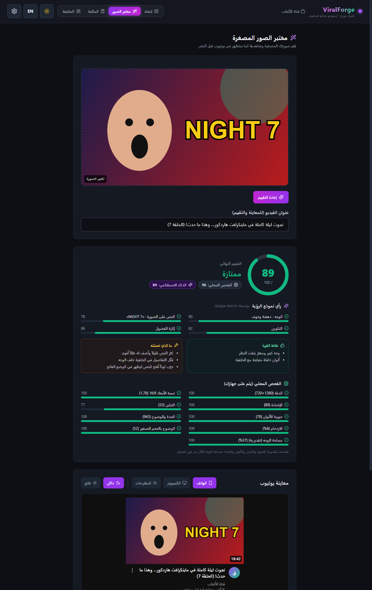
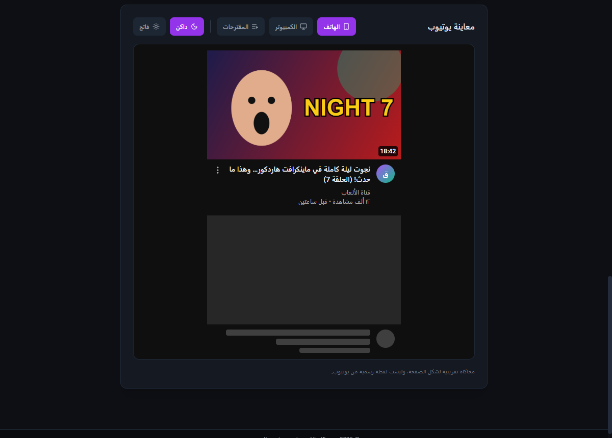
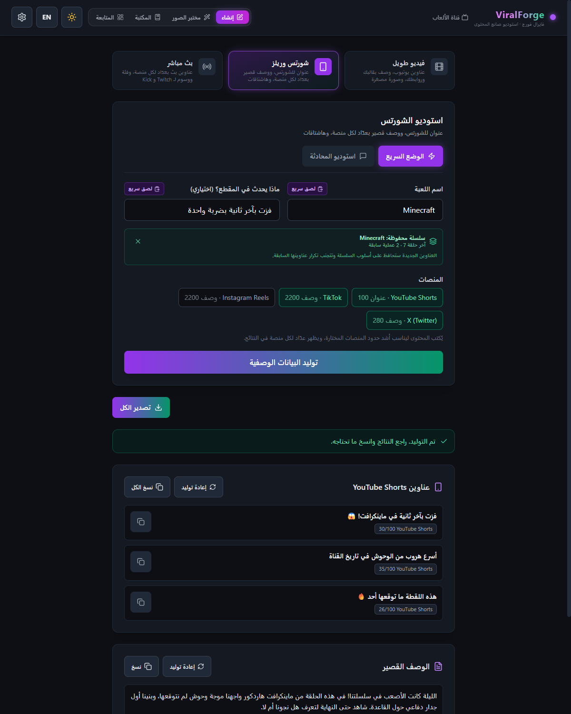
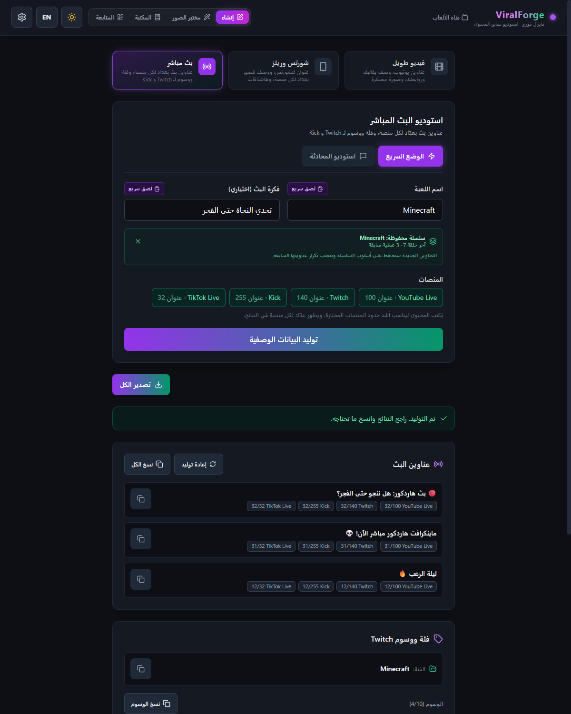
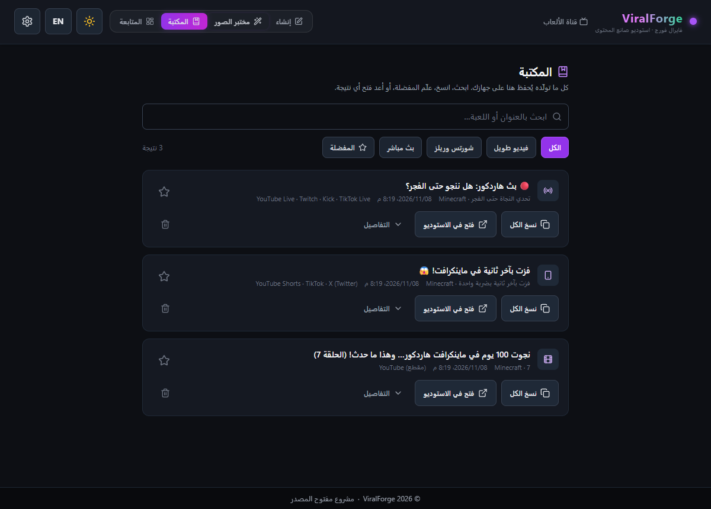

<p align="center"></p>

# ViralForge · فايرال فورج

**استوديو صانع المحتوى (Creator Studio)**: تطبيق مفتوح المصدر لصنّاع محتوى الألعاب. يكتب عناوين يوتيوب، وأوصافاً جاهزة بروابط قناتك، وهاشتاقات مناسبة لكل منصة، ويقيّم صورك المصغرة ويعرضها كما ستظهر في يوتيوب، لثلاثة أنواع من المحتوى: **الفيديو الطويل، الشورتس/الريلز، والبث المباشر**.

| المنصة | الشكل | التحميل |
|---|---|---|
| 🌐 الويب | أي متصفح | النسخة الحية على Vercel |
| 🪟 ويندوز | برنامج تثبيت (يتحدّث تلقائياً) + نسخة محمولة | صفحة [Releases](https://github.com/m7md0xp-boop/viralforge/releases) |
| 🤖 أندرويد | ملف APK | صفحة [Releases](https://github.com/m7md0xp-boop/viralforge/releases) |
| 🍎 iOS | مشروع Xcode جاهز | يحتاج حساب Apple Developer للنشر (انظر أدناه) |

> **عن الاسم:** أبقينا **ViralForge** كاسم أساسي لأنه مرتبط بالمستودع والموقع ويصعب نقل الشهرة لاسم جديد، وأضفنا الاسم العربي **فايرال فورج** (يظهر على هواتف أندرويد المضبوطة على العربية وفي الواجهة العربية). كل بيانات الهوية في ملف واحد: `shared/brand.json`، وبعد تعديله شغّل `npm run brand` لينتقل الاسم إلى كل الملفات.

---

## 📸 نظرة على التطبيق

### شاشة الترحيب (أول تشغيل)


### استوديو الفيديو الطويل


### نتائج الفيديو الطويل: برومبت الصورة المصغرة والعناوين


### مختبر الصور المصغرة: فحص محلي + تقييم بالذكاء الاصطناعي


### معاينة يوتيوب: الهاتف والكمبيوتر والمقترحات، داكن وفاتح


### استوديو الشورتس: عناوين وعدّاد أحرف لكل منصة


### استوديو البث المباشر: عدّادات وفئة ووسوم Twitch و Kick


### المكتبة: كل ما ولّدته محفوظ


### إعدادات مزوّدي الذكاء الاصطناعي


> الصور تُلتقط تلقائياً ببيانات تجريبية: شغّل `npm run dev` ثم `npm run screenshots` في نافذة أخرى.

---

## ✨ المميزات

### ثلاثة استوديوهات منفصلة
كل استوديو يعرض أدواته فقط، ويحتفظ بنتائجه ومنصاته عند التنقل بين الاستوديوهات:

| الاستوديو | المدخلات | النتائج |
|---|---|---|
| 🎬 **الفيديو الطويل** | اللعبة، رقم الحلقة، قالب الوصف، صورتك المرجعية، خيارات التوليد | 3 عناوين بتقديرات الانتشار و SEO و CTR، وصف بقالبك وروابطك، برومبت وصورة مصغرة |
| 📱 **الشورتس والريلز** | اللعبة، ماذا يحدث في المقطع | 3 عناوين لـ YouTube Shorts (عند اختيارها)، وصف قصير بعدّاد أحرف لكل منصة، هاشتاقات بعدد كل منصة |
| 🔴 **البث المباشر** | اللعبة، فكرة البث | 3 عناوين بعدّاد لكل منصة (مثل TikTok Live بحد 32 حرفاً)، فئة ووسوم Twitch و Kick جاهزة للنسخ |

### 🪄 مختبر الصور المصغرة
ارفع صورتك (أو اسحبها، أو الصقها بـ Ctrl+V، أو أرسل الصورة المولّدة بزر «تقييم في المختبر») لتحصل على درجة من 100:
- **فحص محلي على جهازك** (بدون إنترنت): الدقة، نسبة 16:9، الإضاءة، التباين، حيوية الألوان، الحدة، الازدحام، الوضوح بحجم المقترحات الصغير (168×94)، ومساحة الوجه التقديرية من لون البشرة. كل بند له درجة ونصيحة عند الحاجة.
- **تقييم بنموذج رؤية** (Gemini أو ChatGPT أو Claude حسب مفاتيحك): الوجه وتعبيره، النص المكتوب ووضوحه، التكوين، إثارة الفضول مع العنوان، ونقاط القوة وما يجب تحسينه.
- **الدرجة النهائية** = 40% فحص محلي + 60% نموذج الرؤية (أو الفحص المحلي وحده إن لم يتوفر مفتاح).

### 📺 معاينة يوتيوب
الصورة والعنوان كما سيظهران في **الهاتف** و**الكمبيوتر** و**قائمة المقترحات**، في الوضعين **الداكن والفاتح**، بين فيديوهات مجاورة، مع تنبيه إن كان العنوان سيُقطع. (محاكاة تقريبية وليست لقطة رسمية من يوتيوب.)

### 📚 المكتبة وذاكرة السلاسل
- **المكتبة:** كل عملية توليد تُحفظ تلقائياً في قاعدة بيانات محلية (IndexedDB) على جهازك. ابحث، علّم المفضلة ⭐، انسخ، أو أعد فتح أي نتيجة في استوديوها. إعادة توليد العناوين أو الوصف تحدّث نفس النتيجة.
- **ذاكرة السلسلة:** لكل لعبة تعمل عليها سلسلة محفوظة. عندما تكتب اسمها يظهر آخر رقم حلقة، ويُكتب رقم الحلقة التالية تلقائياً بنفس التنسيق (07 ← 08، Part 5 ← Part 6). وتُرسل العناوين السابقة للذكاء الاصطناعي ليحافظ على أسلوب السلسلة دون تكرارها.

### وغيرها
- 👋 **شاشة ترحيب:** يدخل المستخدم اسم قناته وروابطه (القناة، Linktree، Discord) وأسلوب الكتابة مرة واحدة، وتبقى محفوظة على جهازه فقط.
- 📝 **أوصاف جاهزة للنشر:** القالب يُملأ محلياً بروابطك الحقيقية، والذكاء الاصطناعي يكتب النص فقط في مكان `{ai_description}`.
- #️⃣ **هاشتاقات بالعدد الصحيح:** 3-5 ليوتيوب، وحسب حدود كل منصة للشورتس، ولا شيء للبث.
- 🏷️ **وسوم البث:** تُنظَّف لتناسب قواعد Twitch (حتى 10 وسوم، 25 حرفاً لكل وسم). Kick لا تنشر حدوداً رسمية، فنطبّق نفس القواعد احتياطاً.
- 🖼️ **برومبت الصورة المصغرة** حسب نوع اللعبة، وتوليد الصورة من مزوّد صور، أو نسخه وفتحه في Gemini أو ChatGPT.
- 💬 **وضع المحادثة** داخل أي استوديو، مع إدخال صوتي في المتصفحات التي تدعمه.
- 📱 **واجهة الهاتف:** شريط تنقل سفلي، واحترام مساحة النوتش وشريط الرجوع في الهواتف.
- 🌐 **لغة الواجهة** (عربي/إنجليزي) تُحفظ بين الجلسات.
- 🔌 **مزوّدون متعددون:** Gemini و Groq و OpenRouter و Mistral و Cerebras و Cohere و DeepSeek و Claude و ChatGPT للنصوص، و Cloudflare و Gemini و OpenAI للصور.
- 📊 **لوحة متابعة محلية** لإحصائيات الاستخدام.

## 🧩 متغيرات القالب

| المتغير | القيمة |
|---|---|
| `{ai_description}` | النص الذي يكتبه الذكاء الاصطناعي |
| `{game}` / `{episode}` | من حقلي اسم اللعبة ورقم الحلقة |
| `{channel_name}` / `{channel_link}` | من بيانات قناتك |
| `{subscribe_link}` | رابط قناتك مع `?sub_confirmation=1` |
| `{linktree_link}` / `{discord_link}` | من بيانات قناتك |

السطر الذي يحتوي رابطاً فارغاً يُحذف تلقائياً، لذلك ضع العنوان والرابط في نفس السطر (مثال: `💬 Discord: {discord_link}`). لا تضع هاشتاقات في القالب، فالتطبيق يضيفها بالعدد المناسب.

---

## 🛠️ التقنيات

React 18 و Vite 6 و Tailwind CSS، و Electron 45 مع `electron-updater` لنسخة سطح المكتب، و Capacitor 8 لتطبيقي أندرويد و iOS، و IndexedDB للمكتبة، و ESLint 9، واختبارات بـ `node:test` المدمجة في Node.

## 🚀 التشغيل

يتطلب Node.js 18 أو أحدث.

```bash
git clone https://github.com/m7md0xp-boop/viralforge.git
cd viralforge
npm install
npm run dev          # نسخة الويب على http://localhost:5173
npm run build        # بناء نسخة الإنتاج
```

### 🧪 الجودة والاختبارات

```bash
npm run lint         # فحص الكود بـ ESLint
npm test             # الاختبارات (القوالب، الـ Prompts، المنصات، المزوّدون، الترجمات)
npm run check        # الثلاثة معاً: lint ثم test ثم build (شغّله قبل كل Pull Request)
npm run screenshots  # إعادة التقاط صور README (مع تشغيل npm run dev في نافذة أخرى)
```

## 🗂️ هيكل المشروع

```
src/
├── App.jsx                 يربط الـ hooks بالمكوّنات فقط (بدون منطق)
├── main.jsx                نقطة البداية: نافذة التطبيق أو شاشة اختيار المستخدم
├── i18n/                   نظام الترجمة الموحّد
│   ├── locales/ar.js       كل نصوص الواجهة بالعربية
│   ├── locales/en.js       نفس المفاتيح بالإنجليزية
│   ├── translate.js        البحث والمتغيرات {name} (بدون React، تستخدمه الخدمات والاختبارات)
│   ├── I18nProvider.jsx    اللغة الحالية وحفظها واتجاه الصفحة
│   └── useI18n.js          const { t, lang, dir } = useI18n()
├── hooks/                  الحالة والمنطق، hook لكل مسؤولية
│   ├── useStudio.js        الاستوديو المفتوح، منصاته، ونتائج كل استوديو
│   ├── useGeneration.js    التوليد وإعادة التوليد والتصدير والصور
│   ├── useThumbnailLab.js  مختبر الصور: الفحص المحلي وتقييم نموذج الرؤية
│   ├── useLibrary.js, useSeries.js   المكتبة (IndexedDB) وذاكرة السلاسل
│   ├── useTemplateManager.js, useGenerationOptions.js, useReferenceImage.js
│   ├── useProviderSettings.js, useChannelProfile.js, useVoiceInput.js
│   └── useTheme.js, useToast.js, useCopy.js
├── components/
│   ├── layout/             Header, MobileNav (شريط الهاتف), Footer, Toast
│   ├── lab/                ScorePanel (الدرجة والملاحظات), YouTubePreview
│   ├── studio/             تبويبات الاستوديوهات، بطاقة الإدخال، المنصات، القالب، الصورة، الخيارات
│   ├── results/            نتائج الفيديو الطويل والشورتس والبث، وعدّادات الأحرف
│   ├── dialogs/            شاشة الترحيب، الإعدادات
│   ├── screens/            مختبر الصور، المكتبة، لوحة المتابعة، اختيار المستخدم (سطح المكتب)
│   └── ui/                 عناصر مشتركة: Card، أزرار النسخ وإعادة التوليد، ToggleSwitch...
├── config/                 المنصات وحدودها، الـ Prompts، القوالب، الهوية، قائمة المزوّدين
├── services/               المزوّدون، نموذج الرؤية، المكتبة، المفاتيح المشفّرة، الحافظة
└── utils/                  دوال صافية: تحليل الصور، السلاسل، المكتبة، المتغيرات، الهاشتاقات، العدّادات
electron/                   العملية الرئيسية (مع التحديث التلقائي) والـ preload لسطح المكتب
android/  ios/              مشروعا Capacitor الأصليان (Android Studio و Xcode)
shared/brand.json           هوية التطبيق: الاسم بالعربية والإنجليزية، المعرّف، المستودع
shared/aiProviders.json     قائمة المزوّدين، تقرؤها الواجهة ونسخة سطح المكتب معاً
assets/logo.svg             الأيقونة الأصلية (npm run icons يولّد منها كل المقاسات)
.github/workflows/          CI لكل دفعة، و Release لبناء ونشر كل المنصات
tests/                      اختبارات node:test
scripts/                    التقاط الصور، توليد الأيقونات، نشر الهوية
```

### 🌐 إضافة نص أو ترجمة
1. أضف المفتاح في `src/i18n/locales/ar.js` و `src/i18n/locales/en.js` بنفس المكان.
2. استخدمه في المكوّن: `t('group.key')`، أو مع متغير: `t('settings.keyRequired', { provider })`.
3. لا تكتب نصوصاً عربية داخل `src/components`: الاختبارات تتأكد أن المفاتيح متطابقة في اللغتين، وأن كل مفتاح مستخدم موجود، وأن المكوّنات خالية من النصوص الثابتة.

أسماء المزوّدين والمنصات بيانات وليست نصوص واجهة، لذلك تبقى في `shared/aiProviders.json` و `src/config/platforms.js`.

### 🪟 نسخة سطح المكتب (Windows)

```bash
npm run desktop   # تشغيل البرنامج كتطبيق سطح مكتب للتجربة
npm run dist      # بناء برنامج التثبيت والنسخة المحمولة داخل مجلد release
```

- **التحديث التلقائي:** النسخة المثبّتة تفحص صفحة Releases عند التشغيل وكل 6 ساعات، تنزّل الإصدار الجديد في الخلفية، وتثبّته عند إغلاق البرنامج. النسخة المحمولة لا تتحدث تلقائياً.
- **التوقيع الرقمي:** بدون شهادة يعمل البرنامج لكن يظهر تحذير Windows SmartScreen. لإزالته أضف شهادة توقيع (Code Signing) في أسرار المستودع: `WIN_CSC_LINK` (ملف ‎.pfx بصيغة base64) و `WIN_CSC_KEY_PASSWORD`. شهادات EV تزيل التحذير فوراً، والعادية بعد أن تكتسب سمعة. بديل أرخص: Azure Trusted Signing.

### 📱 تطبيقا أندرويد و iOS (Capacitor)

```bash
npm run mobile:sync   # بناء الويب ونسخه إلى المشروعين الأصليين
npm run android       # فتح المشروع في Android Studio (يتطلب JDK 21 و Android SDK)
npm run ios           # فتح المشروع في Xcode (يتطلب جهاز Mac)
npm run icons         # توليد كل الأيقونات وشاشات البداية من assets/logo.svg
npm run brand         # نقل الاسم من shared/brand.json إلى كل الملفات
```

- **أندرويد:** يُبنى ملف APK تلقائياً عند كل إصدار. لنشر نسخة موقّعة (مطلوبة لمتجر Google Play) أضف الأسرار: `ANDROID_KEYSTORE_BASE64` و `ANDROID_KEYSTORE_PASSWORD` و `ANDROID_KEY_ALIAS` و `ANDROID_KEY_PASSWORD`. بدونها يُنشر APK موقّع بمفتاح تجريبي (يعمل على أي هاتف مع تفعيل «مصادر غير معروفة»). اسم التطبيق يظهر «فايرال فورج» على الهواتف المضبوطة على العربية.
- **iOS:** المشروع جاهز ويُتحقق من بنائه تلقائياً، لكن تثبيته على آيفون يتطلب حساب Apple Developer (99$ سنوياً) للتوقيع والنشر عبر TestFlight أو App Store.
- المفاتيح في تطبيقي الجوال تُحفظ داخل مساحة التطبيق المعزولة على الهاتف.

### 🚀 نشر إصدار جديد

1. غيّر `version` في `package.json` (مثلاً `0.3.0`).
2. أنشئ وسماً بنفس الرقم وادفعه:
   ```bash
   git tag v0.3.0
   git push origin v0.3.0
   ```
3. يبني GitHub Actions تلقائياً: برنامج تثبيت ويندوز + النسخة المحمولة + ملفات التحديث التلقائي + APK أندرويد، ويتحقق من بناء iOS، ثم ينشرها كلها في صفحة Releases.

---

## 🔐 الأمان والخصوصية

- **لا خادم ولا جمع بيانات:** بيانات قناتك والمكتبة وذاكرة السلاسل والقوالب تبقى في جهازك. الطلبات تذهب مباشرة إلى مزوّد الذكاء الاصطناعي الذي تختاره.
- **مختبر الصور:** الفحص المحلي يتم على جهازك بالكامل. الصورة لا تُرسل لأي جهة إلا عند الضغط على «تقييم بالذكاء الاصطناعي»، وتُرسل حينها إلى مزوّد نموذج الرؤية الذي في إعداداتك فقط.
- **نسخة سطح المكتب:**
  - المفاتيح مشفّرة بواسطة نظام التشغيل (Electron `safeStorage`). إذا لم يتوفر التشفير يُرفض الحفظ وتظهر رسالة، ولا يُحفظ أي مفتاح كنص عادي.
  - الملفات تُكتب بطريقة آمنة (ملف مؤقت ثم استبدال)، والملف التالف يُنقل جانباً بدل حذفه.
  - تُطبق سياسة أمان المحتوى (CSP)، ولا يُسمح بفتح إلا روابط `http` و `https` في المتصفح الخارجي، والنافذة لا تنتقل لأي موقع خارجي.
  - يعمل نسخة واحدة فقط من البرنامج في نفس الوقت.
- **نسخة الويب:** المفاتيح تُحفظ في `localStorage` لهذا المتصفح فقط. لا تستخدمها على جهاز مشترك. ملف `vercel.json` يضيف ترويسات أمان (منع التضمين في إطارات، nosniff، وغيرها).

## 🛡️ صلاحيات المشرف (للمستقبل)

البنية جاهزة في [`src/config/admin.js`](src/config/admin.js) للوحة تحكم مخفية:

- المشرفون يُحدَّدون بمتغير البيئة `VITE_ADMIN_EMAIL_SHA256` (بصمة SHA-256 للإيميل، وليس الإيميل نفسه)، فلا يظهر أي إيميل في الكود المفتوح أو في الموقع المنشور. راجع [`.env.example`](.env.example).
- على Vercel أضف المتغير من Project Settings ← Environment Variables.
- هذا الفحص يحدد فقط إظهار الواجهة. قراءة إحصائيات المستخدمين تحتاج لاحقاً خادماً يتحقق من تسجيل الدخول (مثل OAuth) ويطبّق نفس القائمة من جهته.

---

## 🧭 أنواع المحتوى وحدود الأحرف

| الاستوديو | المنصة | حد العنوان | حد الوصف | الهاشتاقات |
|---|---|---|---|---|
| فيديو طويل | YouTube | 100 | 5000 | المفضّل 3-5 (حتى 15) |
| شورتس | YouTube Shorts | 100 | 5000 | المفضّل 3-5 (حتى 15) |
| شورتس | TikTok | لا يوجد | 2200 | المفضّل 5-7 |
| شورتس | Instagram Reels | لا يوجد | 2200 | المفضّل 5-10 (حتى 30) |
| شورتس | X (Twitter) | لا يوجد | 280 | المفضّل 2-3 |
| بث | YouTube Live | 100 | - | حتى 15 |
| بث | Twitch | 140 | - | لا هاشتاقات، وبدلها فئة و10 وسوم |
| بث | Kick | 255 | - | لا هاشتاقات، وبدلها فئة ووسوم |
| بث | TikTok Live | 32 | - | - |

عند اختيار أكثر من منصة يُستخدم الحد الأشد بينها.

---

## 🤝 المساهمة

نرحب بالمساهمات:

1. اعمل Fork للمشروع.
2. أنشئ فرعاً جديداً (`git checkout -b feature/AmazingFeature`).
3. تأكد أن `npm run check` ينجح (ESLint والاختبارات والبناء).
4. ارفع التغييرات وافتح Pull Request.

## 📄 الترخيص

مرخّص بموجب رخصة MIT. راجع ملف [LICENSE](LICENSE).
