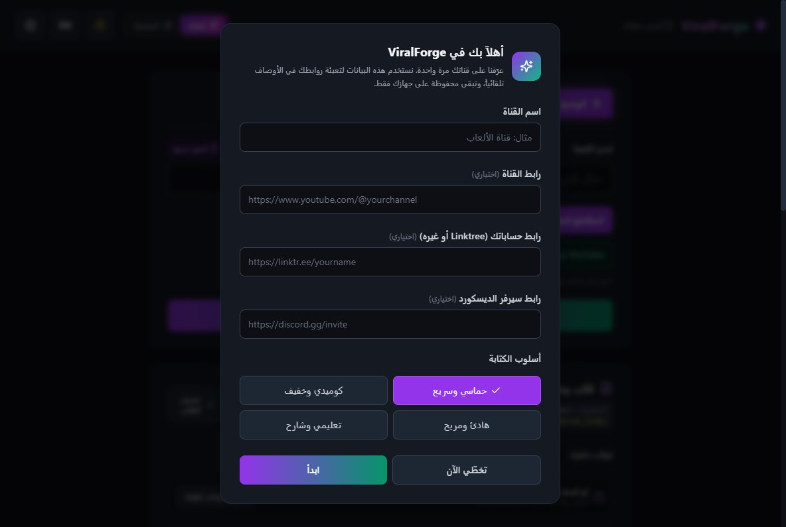
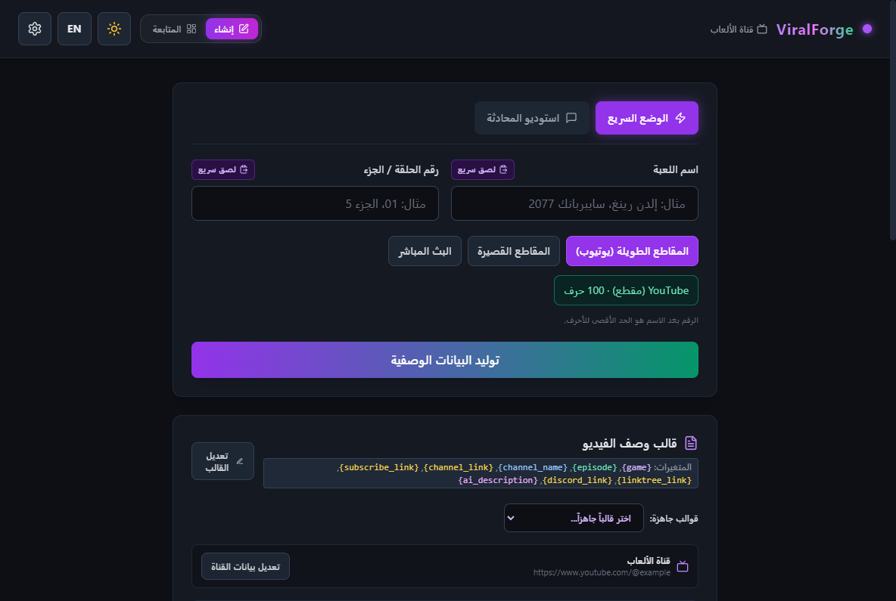
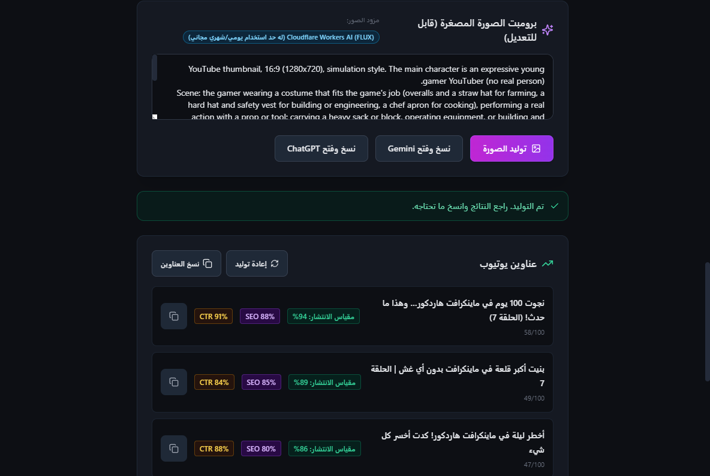
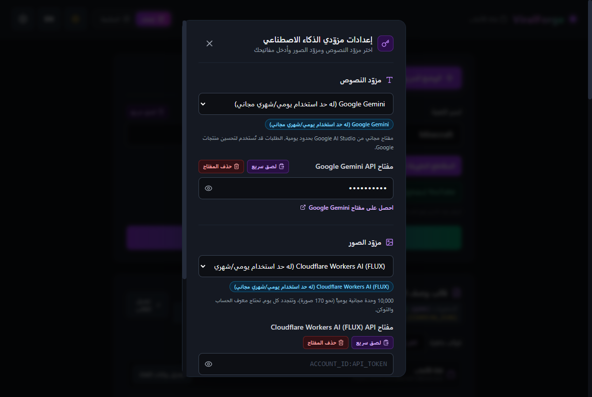

# 🚀 ViralForge

ViralForge مساعد مفتوح المصدر لصنّاع محتوى الألعاب: يكتب عناوين يوتيوب، وأوصافاً جاهزة بروابط قناتك، وهاشتاقات مناسبة لكل منصة، وبرومبت للصورة المصغرة، لثلاثة أنواع من المحتوى: **الفيديو الطويل، الشورتس/الريلز، والبث المباشر**.

يعمل كتطبيق ويب (النسخة الحية على Vercel) وكتطبيق سطح مكتب لويندوز (Electron) يحفظ المفاتيح مشفّرة.

---

## 📸 نظرة على التطبيق

### شاشة الترحيب (أول تشغيل)


### الواجهة الرئيسية


### النتائج: برومبت الصورة المصغرة والعناوين


### إعدادات مزوّدي الذكاء الاصطناعي


> الصور تُلتقط تلقائياً ببيانات تجريبية: شغّل `npm run dev` ثم `npm run screenshots` في نافذة أخرى.

---

## ✨ المميزات

- 👋 **شاشة ترحيب:** يدخل المستخدم اسم قناته وروابطه (القناة، Linktree، Discord) وأسلوب الكتابة مرة واحدة، وتبقى محفوظة على جهازه فقط. يمكن تعديلها لاحقاً من زر القناة في الأعلى.
- 💡 **عناوين يوتيوب** مع تقدير للانتشار و SEO و CTR (تقديرات من الذكاء الاصطناعي وليست أرقاماً رسمية).
- 📝 **أوصاف جاهزة للنشر:** القالب يُملأ محلياً بروابطك الحقيقية، والذكاء الاصطناعي يكتب النص فقط في مكان `{ai_description}`.
- #️⃣ **هاشتاقات بالعدد الصحيح:** 3-5 ليوتيوب (يوتيوب يتجاهل كل الهاشتاقات إذا زادت عن 15)، وحسب حدود كل منصة للشورتس، ولا شيء للبث.
- 🖼️ **برومبت الصورة المصغرة** حسب نوع اللعبة (رعب، محاكاة، أكشن)، وتوليد الصورة مباشرة من مزوّد صور، أو نسخه وفتحه في Gemini أو ChatGPT.
- 💬 **استوديو المحادثة:** اكتب طلبك بحرية، ويُطبَّق على النوع والمنصات المختارة.
- 🔌 **مزوّدون متعددون:** Gemini و Groq و OpenRouter و Mistral و Cerebras و Cohere و DeepSeek و Claude و ChatGPT للنصوص، و Cloudflare و Gemini و OpenAI للصور.
- 📊 **لوحة متابعة محلية** لإحصائيات الاستخدام الخاصة بكل مستخدم.

## 🧩 متغيرات القالب

| المتغير | القيمة |
|---|---|
| `{ai_description}` | النص الذي يكتبه الذكاء الاصطناعي |
| `{game}` / `{episode}` | من حقلي اسم اللعبة ورقم الحلقة |
| `{channel_name}` / `{channel_link}` | من بيانات قناتك |
| `{subscribe_link}` | رابط قناتك مع `?sub_confirmation=1` |
| `{linktree_link}` / `{discord_link}` | من بيانات قناتك |

السطر الذي يحتوي رابطاً فارغاً يُحذف تلقائياً، لذلك ضع العنوان والرابط في نفس السطر (مثال: `💬 Discord: {discord_link}`). لا تضع هاشتاقات في القالب، فالتطبيق يضيفها بالعدد المناسب.

---

## 🛠️ التقنيات

React 18 و Vite 6 و Tailwind CSS، و Electron 33 لنسخة سطح المكتب، واختبارات بـ `node:test`.

## 🚀 التشغيل

يتطلب Node.js 18 أو أحدث.

```bash
git clone https://github.com/m7md0xp-boop/viralforge.git
cd viralforge
npm install
npm run dev          # نسخة الويب على http://localhost:5173
npm test             # اختبارات منطق القوالب والـ Prompts
npm run build        # بناء نسخة الإنتاج
```

### 🪟 نسخة سطح المكتب (Windows)

```bash
npm run desktop   # تشغيل البرنامج كتطبيق سطح مكتب للتجربة
npm run dist      # بناء ملف التثبيت داخل مجلد release (يتطلب ويندوز)
```

---

## 🔐 الأمان والخصوصية

- **لا خادم ولا جمع بيانات:** بيانات قناتك وسجل الاستخدام والقوالب تبقى في جهازك. الطلبات تذهب مباشرة إلى مزوّد الذكاء الاصطناعي الذي تختاره.
- **نسخة سطح المكتب:**
  - المفاتيح مشفّرة بواسطة نظام التشغيل (Electron `safeStorage`). إذا لم يتوفر التشفير يُرفض الحفظ وتظهر رسالة، ولا يُحفظ أي مفتاح كنص عادي.
  - الملفات تُكتب بطريقة آمنة (ملف مؤقت ثم استبدال)، والملف التالف يُنقل جانباً بدل حذفه.
  - تُطبق سياسة أمان المحتوى (CSP)، ولا يُسمح بفتح إلا روابط `http` و `https` في المتصفح الخارجي، والنافذة لا تنتقل لأي موقع خارجي.
  - يعمل نسخة واحدة فقط من البرنامج في نفس الوقت.
- **نسخة الويب:** المفاتيح تُحفظ في `localStorage` لهذا المتصفح فقط. لا تستخدمها على جهاز مشترك. ملف `vercel.json` يضيف ترويسات أمان (منع التضمين في إطارات، nosniff، وغيرها).

## 🛡️ صلاحيات المشرف (للمستقبل)

البنية جاهزة في [`src/config/admin.js`](src/config/admin.js) للوحة تحكم مخفية:

- المشرفون يُحدَّدون بمتغير البيئة `VITE_ADMIN_EMAIL_SHA256` (بصمة SHA-256 للإيميل، وليس الإيميل نفسه)، فلا يظهر أي إيميل في الكود المفتوح أو في الموقع المنشور. راجع [`.env.example`](.env.example).
- على Vercel أضف المتغير من Project Settings ← Environment Variables.
- هذا الفحص يحدد فقط إظهار الواجهة. قراءة إحصائيات المستخدمين تحتاج لاحقاً خادماً يتحقق من تسجيل الدخول (مثل OAuth) ويطبّق نفس القائمة من جهته.

---

## 🧭 أنواع المحتوى وحدود الأحرف

| المنصة | حد العنوان | الهاشتاقات |
|---|---|---|
| YouTube (مقطع) | 100 | المفضّل 3-5 (حتى 15) |
| YouTube Shorts | 100 | المفضّل 3-5 (حتى 15) |
| TikTok | 2200 (الوصف) | المفضّل 5-7 |
| Instagram Reels | 2200 | المفضّل 5-10 (حتى 30) |
| X (Twitter) | 280 | المفضّل 2-3 |
| YouTube Live | 100 | حتى 15 |
| Twitch | 140 | - |
| Kick | 255 | - |
| TikTok Live | 32 | - |

عند اختيار أكثر من منصة يُستخدم الحد الأشد بينها.

---

## 🤝 المساهمة

نرحب بالمساهمات:

1. اعمل Fork للمشروع.
2. أنشئ فرعاً جديداً (`git checkout -b feature/AmazingFeature`).
3. تأكد أن `npm test` و `npm run build` يعملان.
4. ارفع التغييرات وافتح Pull Request.

## 📄 الترخيص

مرخّص بموجب رخصة MIT. راجع ملف [LICENSE](LICENSE).
